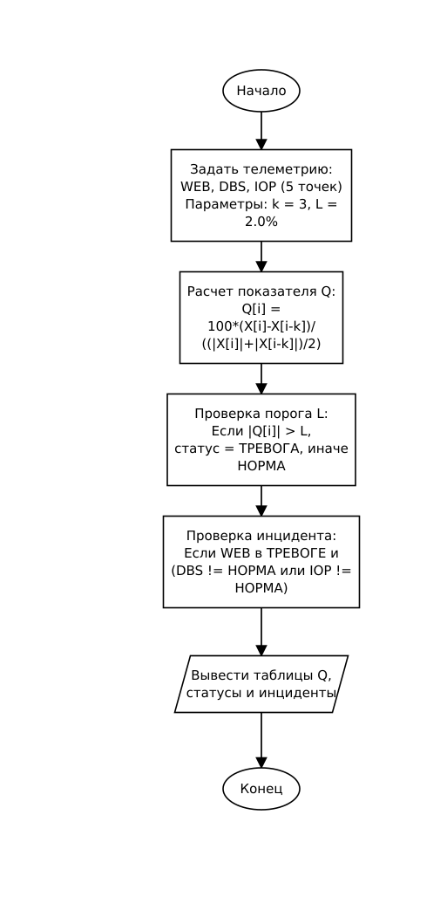

# Курсовой проект: Программа контроля облачной инфраструктуры

## Контрольная точка 1 (КТ1): Пять тестовых значений — формулы и базовый контроль

### Вариант 3

- **Компоненты:** `WEB`, `DBS`, `IOP`
- **Порядок записи во входных данных:** формат `В` (`компонент время значение`, разделитель — пробел).
- **Тип последовательности (2):** порядок компонентов произвольный; на каждом отсчёте присутствуют все три компонента.
- **Телеметрия за пять отсчётов (одна строка):**
  ```text
  DBS 3 57.0 DBS 1 55.6 WEB 1 45.5 DBS 4 55.0 DBS 2 53.6 IOP 4 31.6 WEB 2 46.0 WEB 4 47.0 WEB 5 52.9 IOP 5 30.9 IOP 3 32.4 DBS 5 53.0 IOP 1 33.9 IOP 2 33.1 WEB 3 46.5
  ```
- **Производный показатель $Q$:** Симметрированное относительное изменение
  $$Q[i] = 100 \cdot \frac{X[i] - X[i-k]}{\frac{|X[i]| + |X[i-k]|}{2}}$$
  Параметры: $k = 3$, $L = 2.0\%$, $D = 25$.
- **Правило состояния компонента (Выход за диапазон):**  
  Если $Q < L_{\min}$ или $Q > L_{\max}$ (где $L_{\min} = -L = -2.0\%$, $L_{\max} = L = 2.0\%$), фиксируется состояние **«ТРЕВОГА»**, иначе **«НОРМА»**.
- **Правило инцидента (Комбинация по компоненту):**  
  Инцидент возникает, если первый компонент из списка (`WEB`) находится в состоянии «ТРЕВОГА», а хотя бы один другой компонент не в «НОРМА»:
  $$\text{Incident}(t) = (S_{\text{WEB}}[t] == \text{ТРЕВОГА}) \land ((S_{\text{DBS}}[t] \neq \text{НОРМА}) \lor (S_{\text{IOP}}[t] \neq \text{НОРМА}))$$
- **Структура Incident:**
  ```c
  typedef struct {
      int time;
      int type;
      int count;
  } Incident;
  ```
  Поля: номер отсчёта (`time`), тип инцидента (`type`), число проблемных компонентов (`count`).

---

## 1. Алгоритм и блок-схема

### Описание алгоритма

1. Задать массивы телеметрии из карточки варианта для трёх компонентов (`WEB`, `DBS`, `IOP`) на 5 отсчётов времени ($t = 1 \dots 5$).
2. Задать параметры: шаг сравнения $k = 3$, порог диапазона $L = 2.0\%$.
3. Для каждого компонента вычислить симметрированное относительное изменение $Q[i]$ для отсчётов $i = 4, 5$ (для $t = 1, 2, 3$ пары со сдвигом $k=3$ отсутствуют).
4. Определить состояние компонентов:
   - для отсчётов $t = 1, 2, 3$ данных недостаточно $\rightarrow$ статус «НОРМА»;
   - для отсчётов $t = 4, 5$ проверить условие выхода за диапазон: если $|Q[i]| > L$, статус «ТРЕВОГА», иначе «НОРМА».
5. Проверить возникновение инцидента: если первый компонент (`WEB`) в состоянии «ТРЕВОГА» и хотя бы один из остальных (`DBS`, `IOP`) не в «НОРМА», зафиксировать инцидент, сохранив номер отсчёта, тип и количество проблемных узлов.
6. Вывести исходные данные, показатели $Q$, состояния компонентов и журнал инцидентов.

### Блок-схема алгоритма (КТ1)



---

## 2. Контрольный пример: ручной расчёт

### Исходные данные телеметрии (упорядочены по отсчётам)

| Отсчёт ($t$) | WEB ($X_1$) | DBS ($X_2$) | IOP ($X_3$) |
| :---: | :---: | :---: | :---: |
| 1 | 45.5 | 55.6 | 33.9 |
| 2 | 46.0 | 53.6 | 33.1 |
| 3 | 46.5 | 57.0 | 32.4 |
| 4 | 47.0 | 55.0 | 31.6 |
| 5 | 52.9 | 53.0 | 30.9 |

### Ручной расчёт производного показателя $Q$ ($k = 3$)

- **Отсчёт $t = 4$ (пара с $t = 1$):**
  - $\text{WEB}: Q[4] = 100 \cdot \frac{47.0 - 45.5}{(47.0 + 45.5) / 2} = 100 \cdot \frac{1.5}{46.25} \approx \mathbf{+3.24\%}$
  - $\text{DBS}: Q[4] = 100 \cdot \frac{55.0 - 55.6}{(55.0 + 55.6) / 2} = 100 \cdot \frac{-0.6}{55.30} \approx \mathbf{-1.08\%}$
  - $\text{IOP}: Q[4] = 100 \cdot \frac{31.6 - 33.9}{(31.6 + 33.9) / 2} = 100 \cdot \frac{-2.3}{32.75} \approx \mathbf{-7.02\%}$

- **Отсчёт $t = 5$ (пара с $t = 2$):**
  - $\text{WEB}: Q[5] = 100 \cdot \frac{52.9 - 46.0}{(52.9 + 46.0) / 2} = 100 \cdot \frac{6.9}{49.45} \approx \mathbf{+13.95\%}$
  - $\text{DBS}: Q[5] = 100 \cdot \frac{53.0 - 53.6}{(53.0 + 53.6) / 2} = 100 \cdot \frac{-0.6}{53.30} \approx \mathbf{-1.13\%}$
  - $\text{IOP}: Q[5] = 100 \cdot \frac{30.9 - 33.1}{(30.9 + 33.1) / 2} = 100 \cdot \frac{-2.2}{32.00} \approx \mathbf{-6.88\%}$

### Определение состояний и инцидентов ($L = 2.0\%$)

| Отсчёт ($t$) | $Q(\text{WEB})$ | $Q(\text{DBS})$ | $Q(\text{IOP})$ | Статус WEB | Статус DBS | Статус IOP | Инцидент |
| :---: | :---: | :---: | :---: | :---: | :---: | :---: | :---: |
| 1 | — | — | — | НОРМА | НОРМА | НОРМА | Нет |
| 2 | — | — | — | НОРМА | НОРМА | НОРМА | Нет |
| 3 | — | — | — | НОРМА | НОРМА | НОРМА | Нет |
| 4 | $+3.24\%$ | $-1.08\%$ | $-7.02\%$ | **ТРЕВОГА** ($> 2.0\%$) | НОРМА | **ТРЕВОГА** ($< -2.0\%$) | **Да (тип 1, узлов: 2)** |
| 5 | $+13.95\%$ | $-1.13\%$ | $-6.88\%$ | **ТРЕВОГА** ($> 2.0\%$) | НОРМА | **ТРЕВОГА** ($< -2.0\%$) | **Да (тип 1, узлов: 2)** |

Ожидаемый результат: инциденты возникают на отсчётах **4** и **5** с количеством проблемных компонентов **2** (`WEB` и `IOP`).

---

## 3. Реализация программы

Исходный код программы: [Source.c](Source.c)

---

## 4. Результаты работы программы

Вывод программы в консоли:

```text
Контроль облачной инфраструктуры (Вариант 3, КТ1)

Исходные данные телеметрии:
Отсчет  WEB     DBS     IOP
1       45.5    55.6    33.9
2       46.0    53.6    33.1
3       46.5    57.0    32.4
4       47.0    55.0    31.6
5       52.9    53.0    30.9

Симметрированное относительное изменение Q (%) при k = 3:
Отсчет  Q(WEB)          Q(DBS)          Q(IOP)
4        +3.24%          -1.08%          -7.02%
5       +13.95%          -1.13%          -6.88%

Состояние компонентов (порог L = 2.0%):
Отсчет  WEB             DBS             IOP
1       НОРМА           НОРМА           НОРМА  
2       НОРМА           НОРМА           НОРМА  
3       НОРМА           НОРМА           НОРМА  
4       ТРЕВОГА         НОРМА           ТРЕВОГА
5       ТРЕВОГА         НОРМА           ТРЕВОГА

Журнал инцидентов (WEB в тревоге + сбой других узлов):
Отсчет 4: зафиксирован инцидент (тип 1, проблемных узлов: 2)
Отсчет 5: зафиксирован инцидент (тип 1, проблемных узлов: 2)
```

Вывод программы полностью совпадает с ручным контрольным расчётом.

---

## 5. Вывод

В ходе выполнения контрольной точки 1 реализован базовый расчёт симметрированного относительного изменения динамики компонентов и проверено комбинированное правило выявления инцидентов для пяти тестовых отсчётов.

---

## 6. Информация о разработчике

- **Студент:** Аносов Сергей Юрьевич
- **Группа:** бОТИ-261
- **Год:** 2026
