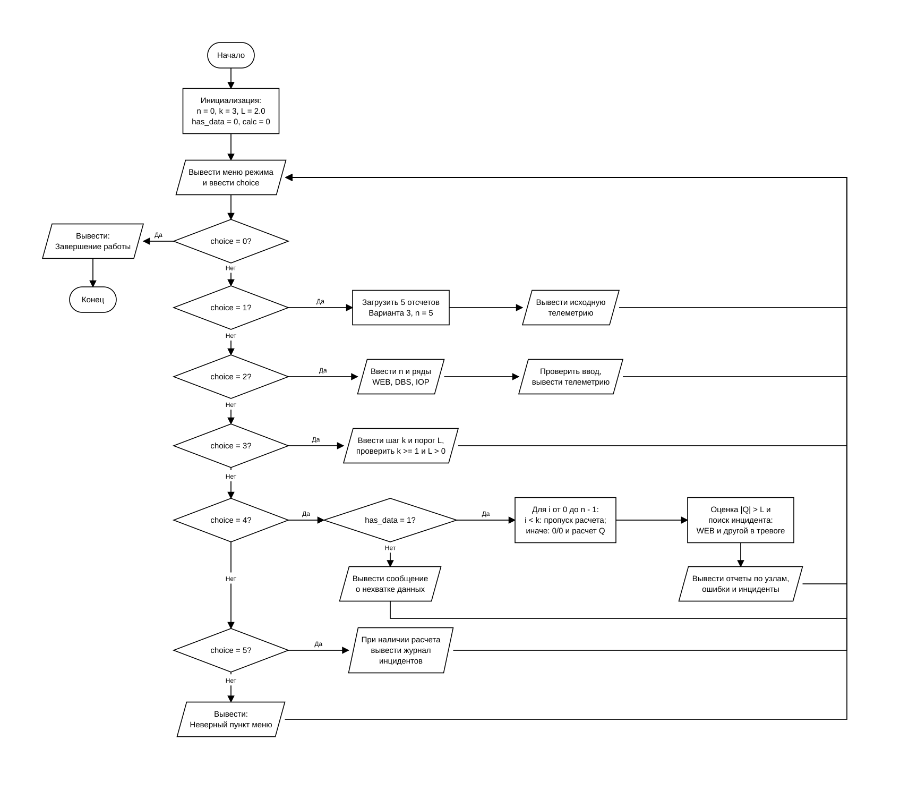

# Курсовой проект: Программа контроля облачной инфраструктуры

## Контрольная точка 2 (КТ2): Структура программы (MVP)

### Назначение программы и описание варианта (Вариант 3)

Программа предназначена для анализа телеметрических временных рядов облачной инфраструктуры, расчёта производного показателя динамики $Q$, оценки состояния компонентов и фиксации инцидентов по заданному логическому правилу.

- **Компоненты инфраструктуры:**
  - `WEB` — веб-сервер (нагрузка / время отклика интерфейса);
  - `DBS` — сервер баз данных (нагрузка подсистемы хранения и запросов);
  - `IOP` — подсистема ввода-вывода (операции ввода-вывода).
- **Формат входных данных (Вариант 3):** формат `В` (`компонент время значение`, разделитель — пробел). Тип последовательности (2): порядок компонентов произвольный, на каждом отсчёте присутствуют все три компонента.
  - На этапе КТ2 программа работает со встроенным контрольным набором из 5 отсчётов и ручным вводом рядов по отсчётам (`WEB DBS IOP`); чтение произвольно перемешанных записей формата `В` из файла выполняется на этапе КТ3.
- **Тестовая телеметрия за пять отсчётов (одна строка варианта):**
  ```text
  DBS 3 57.0 DBS 1 55.6 WEB 1 45.5 DBS 4 55.0 DBS 2 53.6 IOP 4 31.6 WEB 2 46.0 WEB 4 47.0 WEB 5 52.9 IOP 5 30.9 IOP 3 32.4 DBS 5 53.0 IOP 1 33.9 IOP 2 33.1 WEB 3 46.5
  ```
- **Базовые параметры варианта:** $k = 3$, $L = 2.0\%$, $D = 25$.

### Математическая модель и правила контроля

1. **Производный показатель $Q$ (симметрированное относительное изменение, в %):**
   $$Q[i] = 100 \cdot \frac{X[i] - X[i-k]}{\frac{|X[i]| + |X[i-k]|}{2}}$$
   Расчёт выполняется для всех отсчётов, начиная с индекса $i \ge k$, по паре значений $X[i]$ и $X[i-k]$.
   - Для первых $k$ элементов ($i < k$) расчёт $Q$ не выполняется (недостаточно предыстории), статус расчёта — «нет предыстории», состояние компонента — «НОРМА».
   - Если знаменатель $\frac{|X[i]| + |X[i-k]|}{2} < 10^{-6}$ (оба значения пары равны нулю), фиксируется ошибка деления на ноль (`ОШИБКА (/0)`), состояние компонента — «ОШИБКА».
   - При некорректном числе (`NaN`/`Inf`) фиксируется ошибка значения (`ОШИБКА (число)`).
2. **Правило состояния компонента (выход за диапазон):**
   - Если $Q[i] < -L$ или $Q[i] > L$ (при $L_{\min} = -L$, $L_{\max} = L$), состояние компонента — **«ТРЕВОГА»**;
   - иначе — **«НОРМА»**.
3. **Правило инцидента (комбинация по компоненту):**
   Инцидент возникает, если первый компонент из списка (`WEB`) находится в состоянии «ТРЕВОГА», а хотя бы один из других компонентов (`DBS` или `IOP`) также находится в тревоге:
   $$\text{Incident}(t) = (S_{\text{WEB}}[t] == \text{ТРЕВОГА}) \land ((S_{\text{DBS}}[t] == \text{ТРЕВОГА}) \lor (S_{\text{IOP}}[t] == \text{ТРЕВОГА}))$$

### Организация данных

- Для хранения рядов используются статические массивы фиксированного максимального размера (`MAX_POINTS = 100`):
  - исходные ряды: `web[]`, `dbs[]`, `iop[]`;
  - вычисленные показатели: `q_web[]`, `q_dbs[]`, `q_iop[]`;
  - статусы вычисления формулы: `st_web[]`, `st_dbs[]`, `st_iop[]` (`STATUS_OK`, `STATUS_NO_HISTORY`, `STATUS_DIV_ZERO`, `STATUS_INVALID`);
  - состояния компонентов: `state_web[]`, `state_dbs[]`, `state_iop[]` (`STATE_NORMAL`, `STATE_ALARM`, `STATE_ERROR`);
  - массив выявленных инцидентов `incidents[]` из структур `Incident`:
    ```c
    typedef struct {
        int time;
        int type;
        int count;
    } Incident;
    ```

---

## 1. Алгоритм и блок-схема

### Алгоритм работы программы

1. Инициализировать параметры режима по умолчанию: $n = 0$, $k = 3$, $L = 2.0\%$, флаги наличия данных `has_data = 0` и выполнения расчёта `is_calculated = 0`.
2. В цикле `do-while` отображать текущие настройки и меню режима работы, считывать пункт `choice` и обрабатывать его через `switch`:
   - **Пункт 1 (`load_test_data`):** загрузить 5 тестовых отсчётов варианта 3 в массивы `web`, `dbs`, `iop`, установить `n = 5`, вывести исходную таблицу.
   - **Пункт 2 (`input_series`):** запросить количество отсчётов $n$ ($1 \le n \le 100$) и считать тройки значений `WEB DBS IOP` с проверкой корректности ввода.
   - **Пункт 3 (настройка параметров):** запросить шаг сравнения $k$ ($1 \le k < 100$) и порог $L > 0$, проверить ввод; при $k \ge n$ вывести предупреждение о нехватке предыстории для всех точек.
   - **Пункт 4 (расчёт и вывод результатов):** для каждого компонента вызвать `analyze_component()`, где при $i < k$ фиксируется отсутствие предыстории, а при $i \ge k$ выполняется проверка пары функцией `validate_pair()`, расчёт показателя `calc_q()` и оценка состояния `check_state()`. Далее собрать инциденты через `collect_incidents()` с проверкой правила `check_incident()` и вывести отчёты по компонентам, число ошибок вычислений и журнал инцидентов.
   - **Пункт 5 (`print_incidents`):** при наличии данных и выполненного расчёта вывести журнал выявленных инцидентов.
   - **Пункт 0:** завершить работу программы.

### Блок-схема алгоритма (КТ2)



*Исходник схемы для draw.io: [Kursach_KT2_AlgSchema.drawio](Kursach_KT2_AlgSchema.drawio)*

---

## 2. Контрольный пример: ручной расчёт

### Исходные данные телеметрии варианта 3 (упорядочены по отсчётам)

| Отсчёт ($t$) | WEB ($X_1$) | DBS ($X_2$) | IOP ($X_3$) |
| :---: | :---: | :---: | :---: |
| 1 | 45.5 | 55.6 | 33.9 |
| 2 | 46.0 | 53.6 | 33.1 |
| 3 | 46.5 | 57.0 | 32.4 |
| 4 | 47.0 | 55.0 | 31.6 |
| 5 | 52.9 | 53.0 | 30.9 |

### Вариант расчёта 1: шаг $k = 3$, порог $L = 2.0\%$

- **Отсчёты $t = 1, 2, 3$:** $i < k$, расчёт не выполняется, состояние — `НОРМА`.
- **Отсчёт $t = 4$ (пара с $t = 1$):**
  - $\text{WEB}: Q[4] = 100 \cdot \frac{47.0 - 45.5}{(47.0 + 45.5) / 2} = 100 \cdot \frac{1.5}{46.25} \approx \mathbf{+3.24\%}$ (`ТРЕВОГА`)
  - $\text{DBS}: Q[4] = 100 \cdot \frac{55.0 - 55.6}{(55.0 + 55.6) / 2} = 100 \cdot \frac{-0.6}{55.30} \approx \mathbf{-1.08\%}$ (`НОРМА`)
  - $\text{IOP}: Q[4] = 100 \cdot \frac{31.6 - 33.9}{(31.6 + 33.9) / 2} = 100 \cdot \frac{-2.3}{32.75} \approx \mathbf{-7.02\%}$ (`ТРЕВОГА`)
  - Инцидент на $t = 4$: **Да** (тип 1, проблемных узлов: 2 — `WEB` и `IOP`).
- **Отсчёт $t = 5$ (пара с $t = 2$):**
  - $\text{WEB}: Q[5] = 100 \cdot \frac{52.9 - 46.0}{(52.9 + 46.0) / 2} = 100 \cdot \frac{6.9}{49.45} \approx \mathbf{+13.95\%}$ (`ТРЕВОГА`)
  - $\text{DBS}: Q[5] = 100 \cdot \frac{53.0 - 53.6}{(53.0 + 53.6) / 2} = 100 \cdot \frac{-0.6}{53.30} \approx \mathbf{-1.13\%}$ (`НОРМА`)
  - $\text{IOP}: Q[5] = 100 \cdot \frac{30.9 - 33.1}{(30.9 + 33.1) / 2} = 100 \cdot \frac{-2.2}{32.00} \approx \mathbf{-6.87\%}$ (`ТРЕВОГА`, с учётом точности `float`)
  - Инцидент на $t = 5$: **Да** (тип 1, проблемных узлов: 2 — `WEB` и `IOP`).

### Вариант расчёта 2: проверка переменного шага $k = 2$, порог $L = 2.0\%$

- **Отсчёты $t = 1, 2$:** $i < 2$, расчёт не выполняется, состояние — `НОРМА`.
- **Отсчёт $t = 3$ (пара с $t = 1$):** $\text{WEB} = +2.17\%$ (`ТРЕВОГА`), $\text{DBS} = +2.49\%$ (`ТРЕВОГА`), $\text{IOP} = -4.52\%$ (`ТРЕВОГА`) $\rightarrow$ инцидент (3 узла).
- **Отсчёт $t = 4$ (пара с $t = 2$):** $\text{WEB} = +2.15\%$ (`ТРЕВОГА`), $\text{DBS} = +2.58\%$ (`ТРЕВОГА`), $\text{IOP} = -4.64\%$ (`ТРЕВОГА`) $\rightarrow$ инцидент (3 узла).
- **Отсчёт $t = 5$ (пара с $t = 3$):** $\text{WEB} = +12.88\%$ (`ТРЕВОГА`), $\text{DBS} = -7.27\%$ (`ТРЕВОГА`), $\text{IOP} = -4.74\%$ (`ТРЕВОГА`) $\rightarrow$ инцидент (3 узла).

### Граничный случай: обработка деления на ноль

При вводе 4 отсчётов и шаге $k = 2$, если для `DBS` на отсчётах 2 и 4 поданы значения `0.0` и `0.0`, на отсчёте 4 знаменатель равен $\frac{|0.0| + |0.0|}{2} = 0$. Программа фиксирует ошибку деления на ноль (`ОШИБКА (/0)`), не допускает деления и выставляет узлу статус `ОШИБКА`.

---

## 3. Реализация программы

Исходный код программы: [Source.c](Source.c)

Программа разделена на отдельные функции:
- `validate_pair` — проверка пары значений $X[i]$ и $X[i-k]$ на корректность (`isfinite`) и деление на ноль;
- `calc_q` — вычисление показателя $Q$;
- `check_state` — определение состояния компонента (`НОРМА`, `ТРЕВОГА`, `ОШИБКА`);
- `check_incident` — логическая проверка правила инцидента;
- `analyze_component` — проход по временному ряду одного компонента с учётом первых $k$ элементов;
- `collect_incidents` — формирование массива структур `Incident`;
- `load_test_data`, `input_series` — загрузка тестового набора и ручной ввод данных;
- `print_telemetry`, `print_component_report`, `print_incidents` — вывод таблиц и журнала инцидентов.

---

## 4. Результаты работы программы

### Тестовый набор варианта 3 при $k = 3$ и $k = 2$

```text
Программа контроля облачной инфраструктуры (Вариант 3, КТ2).
Выполняет расчет показателя Q для WEB, DBS, IOP и выявление инцидентов.

Текущий режим: отсчетов n = 0, шаг k = 3, порог L = 2.00%
Меню режима работы:
1 - Загрузить тестовый набор варианта 3 (5 отсчетов)
2 - Ввести временной ряд вручную
3 - Настроить параметры анализа (шаг k и порог L)
4 - Выполнить расчет и вывести результаты анализа
5 - Показать журнал инцидентов
0 - Выход
Ваш выбор: 1

Загружен тестовый набор варианта 3 (5 отсчетов).

Исходные данные телеметрии:
Отсчет  WEB        DBS        IOP
1       45.50      55.60      33.90
2       46.00      53.60      33.10
3       46.50      57.00      32.40
4       47.00      55.00      31.60
5       52.90      53.00      30.90

Текущий режим: отсчетов n = 5, шаг k = 3, порог L = 2.00%
Меню режима работы:
1 - Загрузить тестовый набор варианта 3 (5 отсчетов)
2 - Ввести временной ряд вручную
3 - Настроить параметры анализа (шаг k и порог L)
4 - Выполнить расчет и вывести результаты анализа
5 - Показать журнал инцидентов
0 - Выход
Ваш выбор: 4

Результаты анализа (отсчетов: 5, шаг k = 3, порог L = 2.00%):

Компонент WEB:
Отсчет  Значение   Q (%)          Состояние
1       45.50      --- (i < k)    НОРМА
2       46.00      --- (i < k)    НОРМА
3       46.50      --- (i < k)    НОРМА
4       47.00      +3.24          ТРЕВОГА
5       52.90      +13.95         ТРЕВОГА

Компонент DBS:
Отсчет  Значение   Q (%)          Состояние
1       55.60      --- (i < k)    НОРМА
2       53.60      --- (i < k)    НОРМА
3       57.00      --- (i < k)    НОРМА
4       55.00      -1.08          НОРМА
5       53.00      -1.13          НОРМА

Компонент IOP:
Отсчет  Значение   Q (%)          Состояние
1       33.90      --- (i < k)    НОРМА
2       33.10      --- (i < k)    НОРМА
3       32.40      --- (i < k)    НОРМА
4       31.60      -7.02          ТРЕВОГА
5       30.90      -6.87          ТРЕВОГА

Ошибок вычисления формулы: 0
Журнал инцидентов (правило: WEB в ТРЕВОГА и хотя бы один другой в ТРЕВОГА):
  Отсчет 4: инцидент (тип 1, проблемных узлов: 2)
  Отсчет 5: инцидент (тип 1, проблемных узлов: 2)

Текущий режим: отсчетов n = 5, шаг k = 3, порог L = 2.00%
Меню режима работы:
...
Ваш выбор: 3

Текущие параметры: шаг k = 3, порог L = 2.00%
Введите новый шаг сравнения k (от 1 до 99): 2
Введите новый порог L (%, больше 0): 2.0
Параметры обновлены: k = 2, L = 2.00%

Текущий режим: отсчетов n = 5, шаг k = 2, порог L = 2.00%
Меню режима работы:
...
Ваш выбор: 4

Результаты анализа (отсчетов: 5, шаг k = 2, порог L = 2.00%):

Компонент WEB:
Отсчет  Значение   Q (%)          Состояние
1       45.50      --- (i < k)    НОРМА
2       46.00      --- (i < k)    НОРМА
3       46.50      +2.17          ТРЕВОГА
4       47.00      +2.15          ТРЕВОГА
5       52.90      +12.88         ТРЕВОГА

Компонент DBS:
Отсчет  Значение   Q (%)          Состояние
1       55.60      --- (i < k)    НОРМА
2       53.60      --- (i < k)    НОРМА
3       57.00      +2.49          ТРЕВОГА
4       55.00      +2.58          ТРЕВОГА
5       53.00      -7.27          ТРЕВОГА

Компонент IOP:
Отсчет  Значение   Q (%)          Состояние
1       33.90      --- (i < k)    НОРМА
2       33.10      --- (i < k)    НОРМА
3       32.40      -4.52          ТРЕВОГА
4       31.60      -4.64          ТРЕВОГА
5       30.90      -4.74          ТРЕВОГА

Ошибок вычисления формулы: 0
Журнал инцидентов (правило: WEB в ТРЕВОГА и хотя бы один другой в ТРЕВОГА):
  Отсчет 3: инцидент (тип 1, проблемных узлов: 3)
  Отсчет 4: инцидент (тип 1, проблемных узлов: 3)
  Отсчет 5: инцидент (тип 1, проблемных узлов: 3)
```

### Проверка деления на ноль (ручной ввод, 4 отсчёта, $k = 2$)

```text
Ваш выбор: 2

Введите количество отсчетов (от 1 до 100): 4
Отсчет 1 (WEB DBS IOP): 45 50 30
Отсчет 2 (WEB DBS IOP): 46 0 31
Отсчет 3 (WEB DBS IOP): 50 52 27
Отсчет 4 (WEB DBS IOP): 50 0 31

Введено отсчетов: 4.
...
Ваш выбор: 4

Результаты анализа (отсчетов: 4, шаг k = 2, порог L = 2.00%):

Компонент WEB:
Отсчет  Значение   Q (%)          Состояние
1       45.00      --- (i < k)    НОРМА
2       46.00      --- (i < k)    НОРМА
3       50.00      +10.53         ТРЕВОГА
4       50.00      +8.33          ТРЕВОГА

Компонент DBS:
Отсчет  Значение   Q (%)          Состояние
1       50.00      --- (i < k)    НОРМА
2       0.00       --- (i < k)    НОРМА
3       52.00      +3.92          ТРЕВОГА
4       0.00       ОШИБКА (/0)    ОШИБКА

Компонент IOP:
Отсчет  Значение   Q (%)          Состояние
1       30.00      --- (i < k)    НОРМА
2       31.00      --- (i < k)    НОРМА
3       27.00      -10.53         ТРЕВОГА
4       31.00      +0.00          НОРМА

Ошибок вычисления формулы: 1
Журнал инцидентов (правило: WEB в ТРЕВОГА и хотя бы один другой в ТРЕВОГА):
  Отсчет 3: инцидент (тип 1, проблемных узлов: 3)
```

---

## 5. Вывод

В ходе выполнения второго этапа спроектирована модульная структура программы, добавлены массивы для расчёта по паре $X[i]$ и $X[i-k]$ с настраиваемым шагом $k$, обработаны первые $k$ элементов и деление на ноль, а также реализовано меню настройки режима работы. Результаты работы программы совпали с контрольными расчётами.

---

## 6. Информация о разработчике

- **Студент:** Аносов Сергей Юрьевич
- **Группа:** бОТИ-261
- **Год:** 2026
